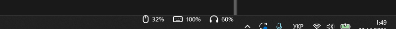

# 🔋 BatteryTray

**Заряд бездротової мишки, клавіатури та навушників — прямо на панелі задач Windows.**



Мінімалістичний віджет біля трею: значок пристрою і відсоток заряду поруч. Без вікон, без налаштувань, без зайвих іконок у прихованому меню «˄».

---

## ✨ Можливості

- **Завжди на виду** — віджет стоїть на самій панелі задач, зліва від стрілки трею, а не ховається в прихованих іконках.
- **Мінімалістичні значки** — мишка (вид зверху), клавіатура, навушники + відсоток.
- **Кольорові підказки**
  - ⚪ звичайний заряд
  - 🟠 30% і менше
  - 🔴 15% і менше + одноразове сповіщення Windows
  - 🟢 заряджається
- **Дружить з автоприховуванням** — плавно їде вгору-вниз разом із панеллю задач.
- **Не заважає в іграх** — у повноекранних застосунках ховається разом із панеллю.
- **Світла й темна тема** — колір тексту підлаштовується під тему Windows.
- **Автозапуск** — стартує разом із Windows.
- **Легка** — ~45 КБ, без встановлення, без залежностей, оновлює дані раз на хвилину.

---

## 📥 Встановлення

Програма не потребує встановлення — це один файл.

1. Відкрий сторінку **[Releases](../../releases/latest)** (праворуч на головній сторінці репозиторію).
2. У розділі **Assets** завантаж **`BatteryTray.exe`**.
3. Поклади файл у будь-яку постійну папку, наприклад `C:\Programs\BatteryTray\`.
   > ⚠️ Не запускай прямо з «Завантажень», якщо плануєш їх чистити — автозапуск посилається саме на це місце.
4. Запусти `BatteryTray.exe` — віджет з'явиться на панелі задач, а програма сама додасться в автозапуск.

### «Windows захистила ваш ПК»?

Файл не підписаний платним цифровим сертифікатом, тому SmartScreen може показати попередження. Це нормально для невеликих open-source програм:

**Докладніше → Виконати однаково**

Не довіряєш готовому exe? [Збери його сам](#-зібрати-з-вихідного-коду) — це займає 2 секунди.

---

## 🖱️ Керування

| Дія | Результат |
|---|---|
| Навести курсор | Підказка з повними назвами пристроїв і зарядом |
| Лівий клік | Оновити заряд зараз |
| Правий клік | Меню: **Оновити** · **Запускати з Windows** · **Вийти** |

Закрити програму можна лише через правий клік по віджету → **Вийти**.

---

## 🎧 Підтримувані пристрої

Windows не має єдиного способу дізнатися заряд бездротових девайсів — кожен виробник використовує свій протокол. BatteryTray вміє говорити з такими:

| Пристрій | Як підключений | Статус |
|---|---|---|
| **Logitech** мишки та клавіатури (G Pro, Superlight, MX…) | Ресивер LIGHTSPEED / Unifying / Bolt (протокол HID++ 2.0) | ✅ |
| **Logitech PRO X 2 LIGHTSPEED** (навушники) | Власний ресивер | ✅ |
| **Attack Shark** та інші клавіатури на чипах YiChip (VID `3151`) | 2.4G ресивер | ✅ (без індикатора заряджання) |
| Будь-які **Bluetooth**-пристрої, що повідомляють заряд Windows | Bluetooth | ✅ |
| Razer, SteelSeries, HyperX, Corsair… | — | ❌ поки ні |

Якщо пристрій вимкнений або заснув, віджет ще 10 хвилин показує останнє відоме значення, а потім прибирає його.

---

## 🛠️ Зібрати з вихідного коду

Нічого встановлювати не потрібно — компілятор C# уже вбудований у Windows (.NET Framework 4).

```powershell
git clone https://github.com/<логін>/<репозиторій>.git
cd <репозиторій>
powershell -ExecutionPolicy Bypass -File build.ps1
```

Поруч з'явиться готовий `BatteryTray.exe`.

### Структура

| Файл | Що робить |
|---|---|
| `Widget.cs` | Віджет на панелі задач, малювання значків, меню, автозапуск |
| `Logitech.cs` | Протокол HID++ (мишки/клави) і протокол навушників PRO X 2 |
| `AttackShark.cs` | Запит статусу ресивера YiChip (лише читання) |
| `Hid.cs` | Низькорівневий доступ до USB HID |
| `BatteryTray.cs` | Bluetooth-пристрої через Windows API |
| `app.manifest` | DPI-awareness і сумісність з Windows 10/11 |
| `build.ps1` | Скрипт збірки |

### Діагностика

```powershell
BatteryTray.exe --list   # показати знайдені пристрої та заряд у консолі
BatteryTray.exe --hid    # перелічити всі HID-інтерфейси
```

> Ці режими пишуть у консоль, тому для них збери консольну версію:
> `powershell -File build.ps1 -Out probe.exe -Target exe`

---

## 🚀 Як випустити нову версію (для автора)

`BatteryTray.exe` не зберігається в коді репозиторію (див. `.gitignore`) — готові збірки публікуються через **GitHub Releases**. Так у репозиторії лише вихідний код, а користувачі завжди мають пронумеровані готові версії.

1. Внеси зміни, збери `build.ps1`, перевір.
2. Закоміть і запуш код:
   ```bash
   git add .
   git commit -m "Опис змін"
   git push
   ```
3. На GitHub: **Releases → Draft a new release**.
4. **Choose a tag** → введи нову версію, наприклад `v1.1` → **Create new tag**.
5. Заповни назву й список змін.
6. Перетягни свіжий `BatteryTray.exe` у поле **Attach binaries**.
7. **Publish release**.

Посилання `../../releases/latest` у цьому README завжди веде на найновішу версію.

---

## 🙏 Подяки

- [sharkfin](https://github.com/dniminenn/sharkfin) — документація протоколу клавіатур YiChip
- [Патч для ядра Linux](https://lwn.net/Articles/1093805/) — протокол заряду Logitech PRO X 2 LIGHTSPEED
- [Solaar](https://github.com/pwr-Solaar/Solaar) — довідка щодо Logitech HID++
